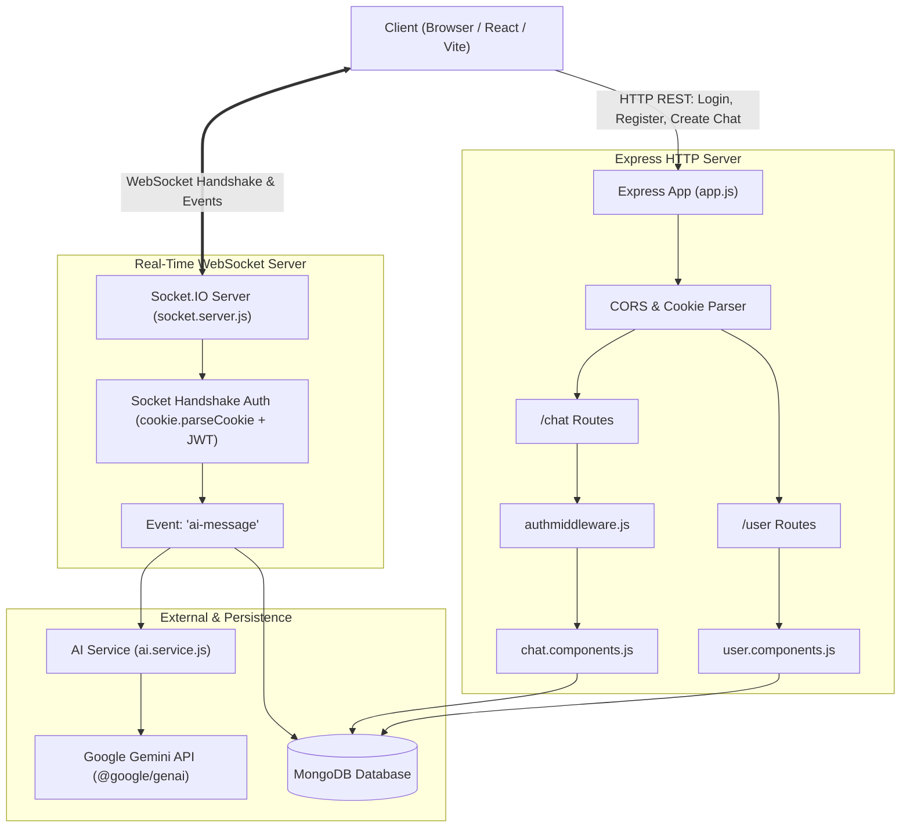
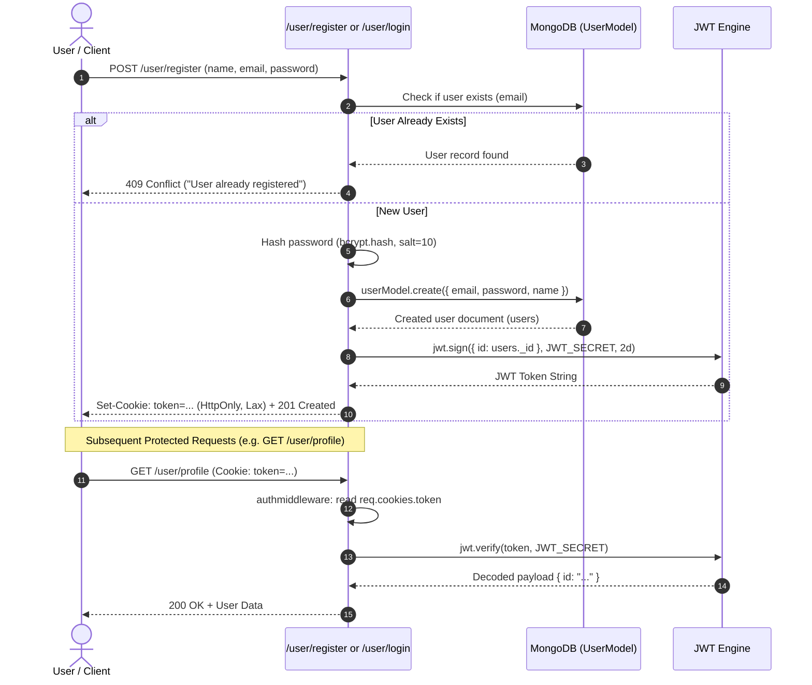
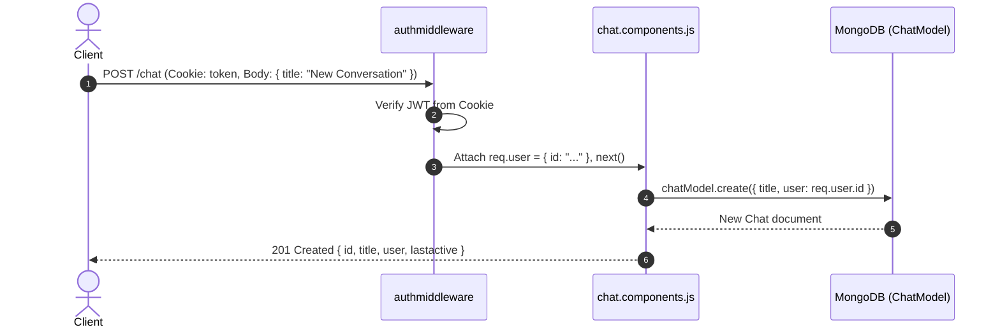
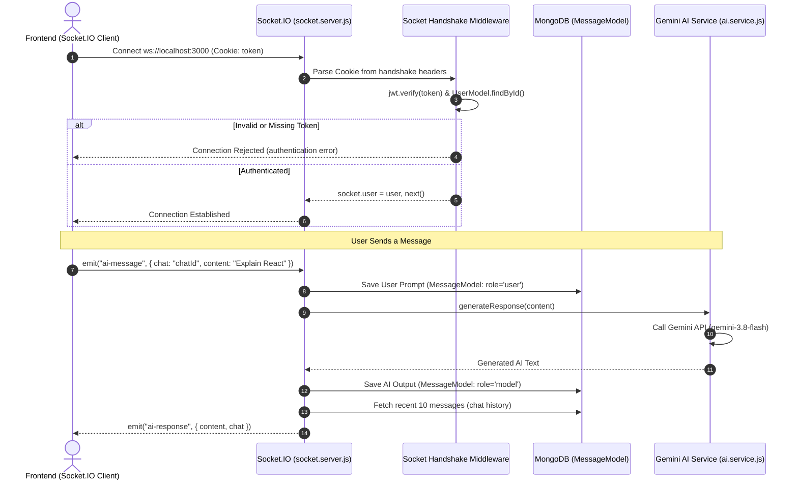
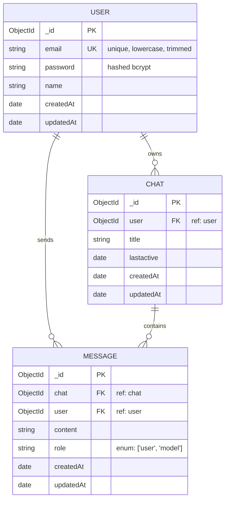

# 🤖 ChatGPT Clone Backend — Architecture, Flowcharts & Debugging Guide

A production-grade, real-time AI Chat backend built with **Node.js**, **Express**, **MongoDB (Mongoose)**, **Socket.IO**, and Google's **Gemini AI API** (`@google/genai`).

---

## 📑 Table of Contents
1. [Overview](#-overview)
2. [Folder Structure](#-folder-structure)
3. [Environment Configuration (.env)](#-environment-configuration-env)
4. [Architecture & System Flowcharts](#-architecture--system-flowcharts)
   - [Overall System Architecture](#1-overall-system-architecture)
   - [Authentication & JWT Cookie Flow](#2-authentication--jwt-cookie-flow)
   - [Chat Creation Flow](#3-chat-creation-flow)
   - [Real-time Socket.IO & Gemini AI Flow](#4-real-time-socketio--gemini-ai-flow)
   - [Database Entity Relationship Diagram (ERD)](#5-database-entity-relationship-diagram-erd)
5. [API Endpoints Reference](#-api-endpoints-reference)
6. [Socket.IO Events Reference](#-socketio-events-reference)
7. [Critical Bugs Detected & Debugging Analysis](#-critical-bugs-detected--debugging-analysis)
8. [Complete Corrected Code with Debug Logs](#-complete-corrected-code-with-debug-logs)
9. [How to Run and Test](#-how-to-run-and-test)

---

## 🌟 Overview

This backend powers a real-time conversational AI chat platform:
- **Authentication**: User Registration, Login, and Profile fetching using JWT stored in secure HTTP-only cookies and passwords hashed with Bcrypt.
- **Chat Management**: REST API endpoints to initialize distinct chat conversations/threads.
- **Real-Time Communication**: Socket.IO server configured with handshake middleware to authenticate users via HTTP-only cookie before granting socket access.
- **AI Intelligence**: Integrated with Google Gemini AI (`@google/genai`) to generate streaming responses and conversation messages.
- **Persistence**: MongoDB database storing Users, Chat sessions, and Message history (role: `user` or `model`).

---

## 📂 Folder Structure

```
backend/
├── .env                          # Secret environment variables (PORT, MONGO_URL, etc.)
├── .gitignore                    # Git ignore file (node_modules, .env)
├── package.json                  # NPM dependencies & scripts
├── server.js                     # Server entrypoint (HTTP + Socket.IO + DB connection)
└── src/
    ├── app.js                    # Express app initialization, middlewares, & routes
    ├── database/
    │   └── db.js                 # MongoDB connection logic (Mongoose)
    ├── models/
    │   ├── usermodel.js          # User schema (email, password, name)
    │   ├── chatmodel.js          # Chat thread schema (user ref, title, lastactive)
    │   └── messagemodel.js       # Message schema (chat ref, user ref, content, role)
    ├── middlewares/
    │   └── authmiddleware.js     # JWT cookie verification middleware for Express routes
    ├── components/               # Controllers (business logic handlers)
    │   ├── user.components.js    # Register, Login, Profile controllers
    │   └── chat.components.js    # Create Chat controller
    ├── routes/
    │   ├── user.routes.js        # /user (register, login, profile)
    │   └── chat.routes.js        # /chat (create chat)
    ├── service/
    │   └── ai.service.js         # Google Gemini AI SDK integration
    └── socket/
        └── socket.server.js      # Socket.IO connection handling & "ai-message" listener
```

---

## 🔑 Environment Configuration (.env)

Create a `.env` file in the root `backend/` directory:

```env
PORT=3000
MONGO_URL=mongodb+srv://<username>:<password>@cluster0.mongodb.net/chatgpt?retryWrites=true&w=majority
JWT_SECRET=your_super_secret_jwt_key_here
GEMINI_API_KEY=your_gemini_api_key_here
NODE_ENV=development
CLIENT_URL=http://localhost:5173
```

> **Note**: In the original `.env`, the variable name was spelled `JWT_SCERET`. The debugged codebase supports both `JWT_SECRET` and fallback to `JWT_SCERET`.

---

## 📊 Architecture & System Flowcharts

### 1. Overall System Architecture



---

### 2. Authentication & JWT Cookie Flow



---

### 3. Chat Creation Flow



---

### 4. Real-time Socket.IO & Gemini AI Flow



---

### 5. Database Entity Relationship Diagram (ERD)



---

## 🌐 API Endpoints Reference

### 1. Register User
- **URL**: `POST /user/register`
- **Headers**: `Content-Type: application/json`
- **Request Body**:
  ```json
  {
    "name": "Alex Smith",
    "email": "alex@example.com",
    "password": "StrongPassword123"
  }
  ```
- **Success Response (201 Created)**:
  - Sets HTTP-Only cookie `token`
  ```json
  {
    "message": "User registered successfully",
    "user": {
      "id": "6720abc123456789...",
      "name": "Alex Smith",
      "email": "alex@example.com"
    }
  }
  ```

### 2. Login User
- **URL**: `POST /user/login`
- **Headers**: `Content-Type: application/json`
- **Request Body**:
  ```json
  {
    "email": "alex@example.com",
    "password": "StrongPassword123"
  }
  ```
- **Success Response (200 OK)**:
  - Sets HTTP-Only cookie `token`
  ```json
  {
    "message": "User logged in successfully",
    "user": {
      "id": "6720abc123456789...",
      "name": "Alex Smith",
      "email": "alex@example.com"
    }
  }
  ```

### 3. Get User Profile
- **URL**: `GET /user/profile`
- **Headers**: Sends automatic `Cookie: token=...`
- **Success Response (200 OK)**:
  ```json
  {
    "message": "Profile retrieved successfully",
    "user": {
      "id": "6720abc123456789...",
      "iat": 1730000000,
      "exp": 1730172800
    }
  }
  ```

### 4. Create Chat
- **URL**: `POST /chat`
- **Headers**: `Content-Type: application/json`, `Cookie: token=...`
- **Request Body**:
  ```json
  {
    "title": "Machine Learning Overview"
  }
  ```
- **Success Response (201 Created)**:
  ```json
  {
    "message": "Chat created successfully",
    "chat": {
      "id": "6720bcd987654321...",
      "title": "Machine Learning Overview",
      "user": "6720abc123456789...",
      "lastactive": "2026-10-28T10:30:00.000Z"
    }
  }
  ```

---

## ⚡ Socket.IO Events Reference

### Connection & Authentication
- **Handshake**: The client connects with `{ withCredentials: true }`.
- The cookie containing `token` is verified automatically in `io.use()`.
- If invalid or missing, connection is rejected with `authentication error`.

### Client Emits: `ai-message`
Payload sent by frontend:
```json
{
  "chat": "6720bcd987654321...",
  "content": "Explain quantum computing in simple terms"
}
```

### Server Emits: `ai-response`
Payload received by frontend:
```json
{
  "content": "Quantum computing is a rapidly-emerging technology that harnesses the laws of quantum mechanics...",
  "chat": "6720bcd987654321..."
}
```

*(Also supports legacy fallback event name `ai-respose`)*

---

## 🐞 Critical Bugs Detected & Debugging Analysis

| # | File & Line | Bug Description | Impact | Fix |
|---|-------------|-----------------|--------|-----|
| **1** | `user.components.js:22` | `jwt.sign({ id: user._id })` used `user` instead of `users` | **Fatal Crash**: `user` is `null` (since findOne returned null). Registration crashes with `TypeError: Cannot read properties of null (reading '_id')`. | Changed to `users._id`. |
| **2** | `user.components.js:10, 47` | Wrong HTTP status codes: Returns `404` for duplicate user and `404` for bad password | Confuses frontend error handling and breaks REST semantics. | Return `409 Conflict` for duplicate user, and `401 Unauthorized` for bad credentials. |
| **3** | `user.components.js:31, 64` | Returning raw hashed password in response: `{ users }` and `{ user }` | **Security Vulnerability**: Leaks bcrypt password hash to the client. | Return sanitized object without password: `{ id, name, email }`. |
| **4** | `user.components.js` & `chat.components.js` | Missing `try/catch` error handlers | Any DB failure or bad input hangs request indefinitely. | Wrapped all async controllers in `try/catch` with structured error responses. |
| **5** | `socket.server.js:44` | Typo in socket event name: `ai-respose` (missing 'n') | Frontend listening for `ai-response` will never receive messages! | Emits `ai-response` (and also `ai-respose` for backwards compatibility). |
| **6** | `socket.server.js:28` | No `try/catch` around `generateResponse()` or DB operations | An AI API error (e.g. rate limit, 503) crashes the socket handler, leaving client waiting forever. | Added robust `try/catch` with `socket.emit("ai-error", ...)` feedback to frontend. |
| **7** | `server.js:8` | `connectedDB()` was called without `await` | Server starts listening before database connection is ready, causing early requests to fail. | Wrapped in `async startServer()` and `await connectedDB()`. |
| **8** | `app.js` | Missing `cors` middleware with credentials support | Cross-Origin requests from frontend (e.g. React/Vite on port 5173) are blocked by browser, and cookies cannot be sent. | Added `cors({ origin: process.env.CLIENT_URL, credentials: true })`. |
| **9** | `ai.service.js:11` | Gemini model names: `gemini-3.5-flash` throws 404/deprecated | Fallback to current available model (`gemini-3.8-flash`) was nested in try/catch. | Updated model priority with graceful fallback and clear logging. |
| **10** | `.env` vs code | Misspelled env key `JWT_SCERET` | Risk of `undefined` JWT key if standard `JWT_SECRET` is used. | Added fallback: `process.env.JWT_SECRET || process.env.JWT_SCERET`. |

---

## 💻 How to Run and Test

### 1. Install Dependencies
```bash
cd backend
npm install
```

### 2. Start Server
```bash
npm start
# or with nodemon:
npx nodemon server.js
```

### 3. Observe Rich Terminal Debug Logs
With the debugged code, you will see real-time color-coded console logs:
```
[DB] 🟢 MongoDB connected successfully!
[SERVER] 🚀 Server running on http://localhost:3000
[SOCKET] ⚡ Socket connected: user=alex@example.com, socketId=x7z9...
[AI] 🤖 Prompt received for chat 6720bcd...: "Explain React"
[AI] ✅ Response generated successfully (420 chars)
[SOCKET] 📤 Emitted ai-response to socketId=x7z9...
```
